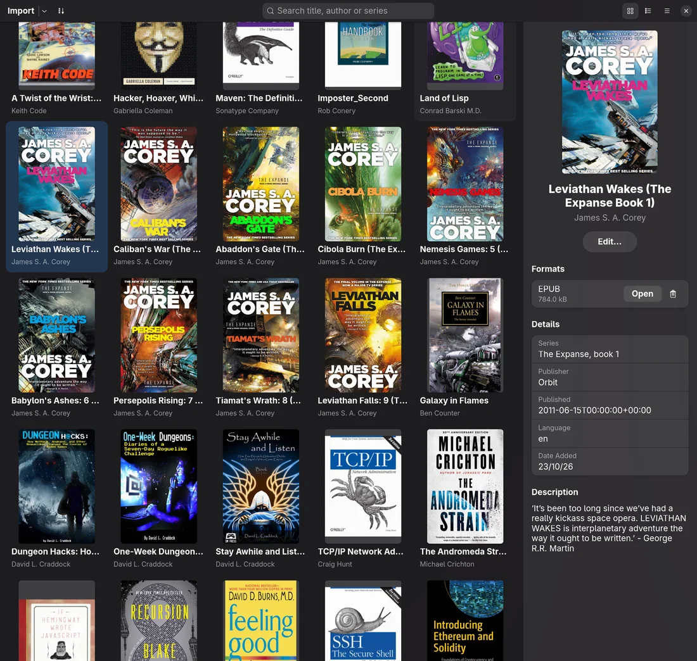
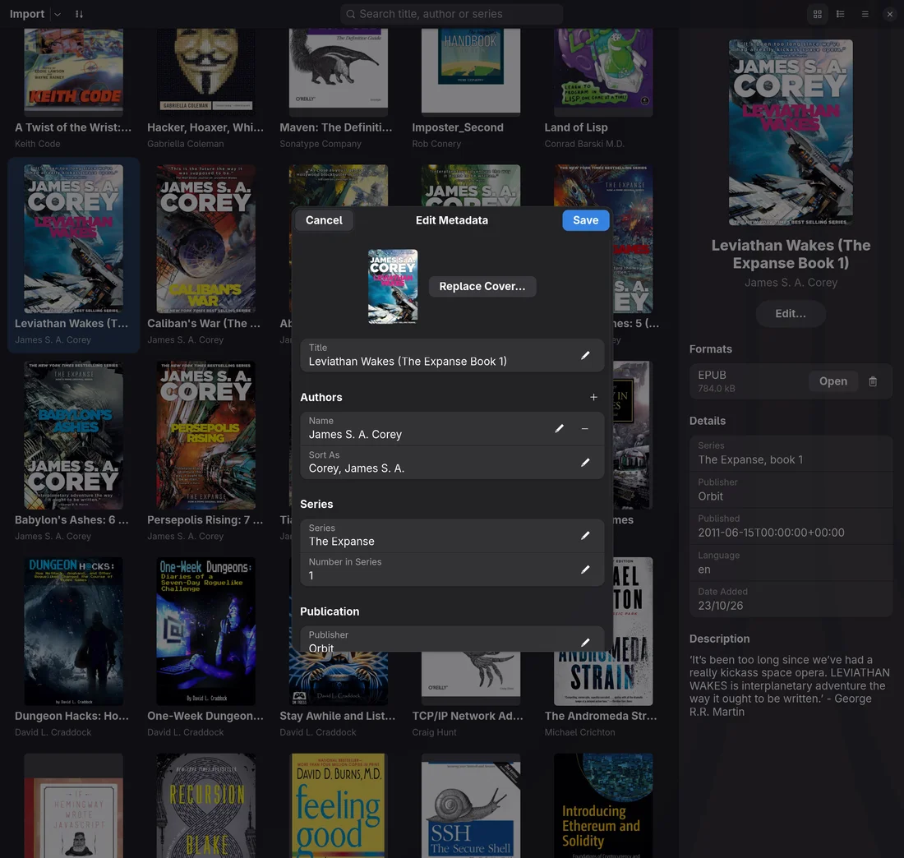

# Armarium

A personal desktop ebook library for DRM-free books on Linux. Built with GTK4 and libadwaita in Rust.

Armarium collects your EPUBs and PDFs into one managed folder, keeps their metadata and covers, and lets you browse them as a cover grid or a list.



## Features

- **Import** files or whole folders. Files are copied, never moved. Duplicates are skipped, and a PDF and EPUB of the same book are merged into one Book.
- **Browse** as a resizable cover grid or a list, sorted by title, author, series, format or date added.
- **Search** as you type, ignoring case and accents ("bronte" finds "Brontë").
- **Edit** metadata (title, authors, series, publisher, ISBN and more) and replace covers. Select several books to change their authors, series, publisher or language at once.
- **Open** books in your default reader, or show them in your file manager.
- **Merge** books that Import kept apart, such as a PDF with no metadata and its EPUB. You pick the book whose metadata and cover to keep, and it gains the others' formats.
- **Delete** to the Trash.
- **Send to a Kindle** over USB. EPUBs are converted to AZW3 with their current metadata and cover, and PDFs are copied as they are; for a book with both, you choose which. Books on the Kindle get a tick, and re-sending a Book keeps its reading position and highlights.

| Editing metadata | Replacing a cover |
| --- | --- |
|  |  |

## Library

The Library lives in `~/Books` by default; you can change this in Preferences. It holds the book files, one folder per Book, plus `library.db` (SQLite), which is the source of truth for metadata. Cover thumbnails are cached under `~/.cache/armarium`.

## Building

Requirements:

- [rustup](https://rustup.rs) (the toolchain is pinned in `rust-toolchain.toml`)
- [just](https://github.com/casey/just)
- GTK 4.22+, libadwaita 1.9+, poppler-glib, SQLite
- `blueprint-compiler`

```sh
rustup toolchain install
just install    # installs to ~/.local, with an app launcher entry
```

`just uninstall` removes it again; your Library and settings are kept.

## Development

Run `just` to list every task. The main ones:

```sh
just run        # development build
just test       # all automated tests
just check      # everything CI runs
just hooks      # enable the repo's git hooks (once per clone)
just try DIR    # fresh scratch Library with books from DIR, then open the app
```

Development builds use their own app id, settings, cache and Library, so they never touch the installed app's data.

### Worktrees

Work happens in git worktrees under `.claude/worktrees/` (see [AGENTS.md](AGENTS.md)). `just wt` picks one with [fzf](https://github.com/junegunn/fzf) and runs a recipe there, using that worktree's own build and scratch Library:

```sh
just wt         # open the chosen worktree's scratch Library
just wt try DIR # any recipe, with its arguments
just wt test
```

Only one development build can be open at a time for now ([#16](https://github.com/rxvt/armarium/issues/16)): launching a second one focuses the window already open.

To `cd` into a worktree instead, add this to your shell config:

```bash
wt() { local d; d=$(git worktree list --porcelain | sed -n 's/^worktree //p' | fzf) && cd "$d"; }
```

Vocabulary is defined in [GLOSSARY.md](GLOSSARY.md), the v1 scope in [docs/v1-plan.md](docs/v1-plan.md), and lasting decisions in [docs/adr/](docs/adr/).

## Credits

Sending to a Kindle would not exist without [calibre](https://calibre-ebook.com) and its author, Kovid Goyal. Calibre has been the go-to ebook manager for nearly two decades, and its AZW3 writer is the product of years of careful reverse engineering of Amazon's formats. Armarium's EPUB to AZW3 conversion (`core/src/azw3/`) is a Rust port of that writer, so the credit for how it works belongs to Kovid and calibre's contributors; any bugs in the port are ours. If you find Armarium useful, please consider [supporting calibre](https://calibre-ebook.com/donate). See [NOTICE](NOTICE) for the files involved.

Armarium is also built on the work of the [GTK](https://gtk.org), [libadwaita](https://gitlab.gnome.org/GNOME/libadwaita), [gtk-rs](https://gtk-rs.org), [Poppler](https://poppler.freedesktop.org) and [SQLite](https://sqlite.org) projects.

## License

Armarium is distributed under the [GNU GPL, version 3](LICENSE) only. Its own code is GPL-3.0-or-later; the files ported from calibre (`core/src/azw3/`) are GPL-3.0-only, as calibre is. [NOTICE](NOTICE) has the details.
